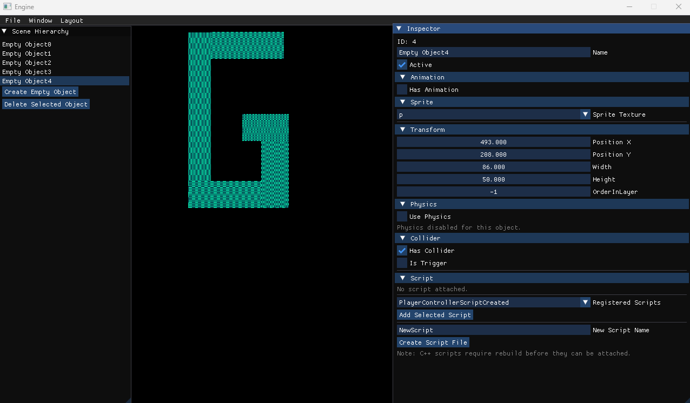
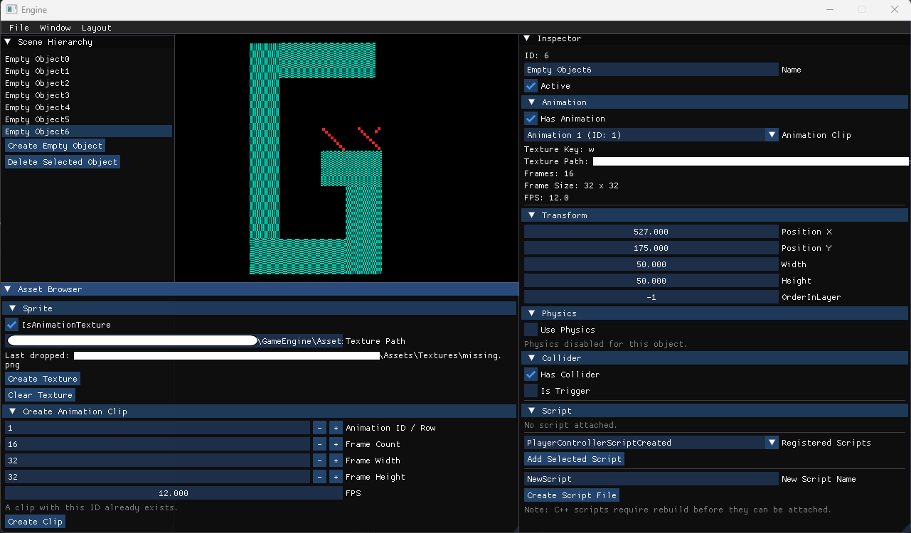
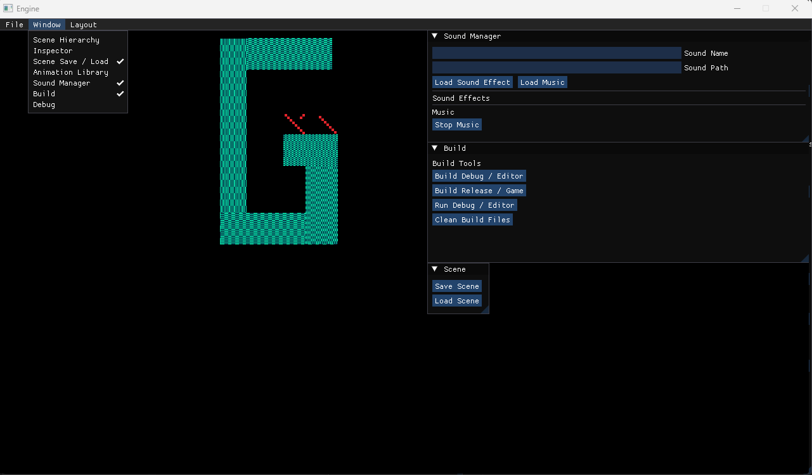
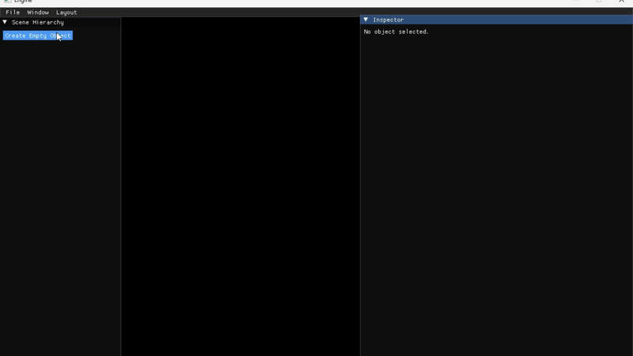

# Mini 2D Game Engine

A lightweight C++ 2D game engine/editor built with SDL2, Box2D, Dear ImGui and SDL_mixer.

## Features

- Editor and Game build separation
- Dear ImGui based editor UI
- GameObject system
- Scene hierarchy and inspector
- AssetManager with texture library
- AnimationManager with ID-based animation clips
- SoundManager with ID-based sound and music system
- Scene save/load system
- Script system with ScriptContext
- Build system from editor UI

## Screenshots

### Editor


### Animation System


### Build System


### Demo



## Tech Stack

- C++
- SDL2
- SDL_image
- SDL_ttf
- SDL_mixer
- Box2D
- Dear ImGui
- Visual Studio 2022

## Build

### Debug / Editor Build

```bat
Build\build-debug.bat
Build\run-debug.bat